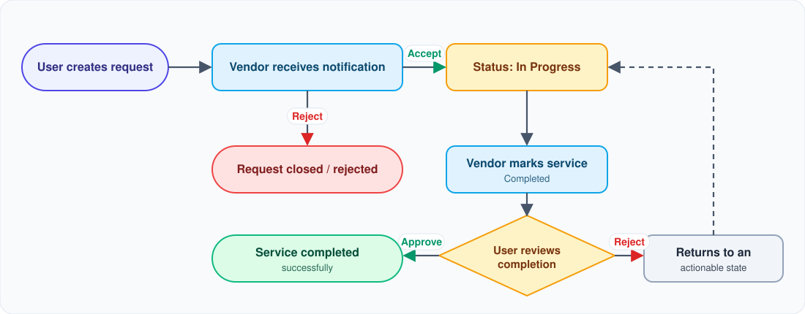
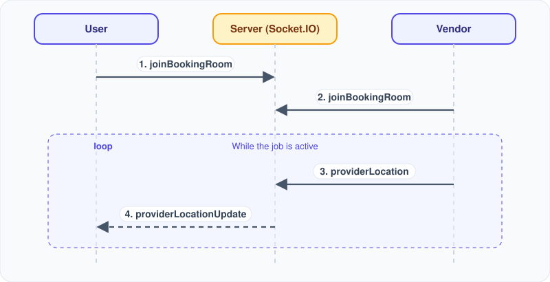
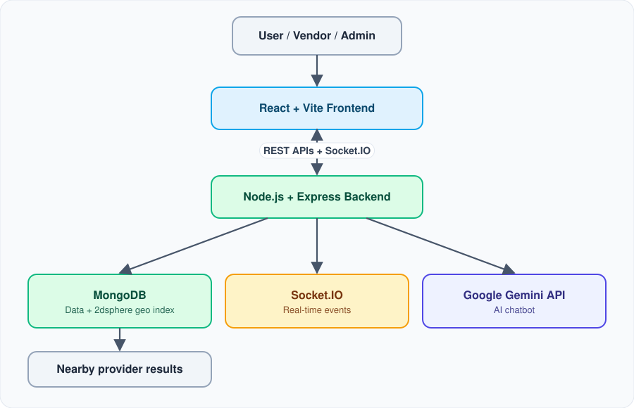
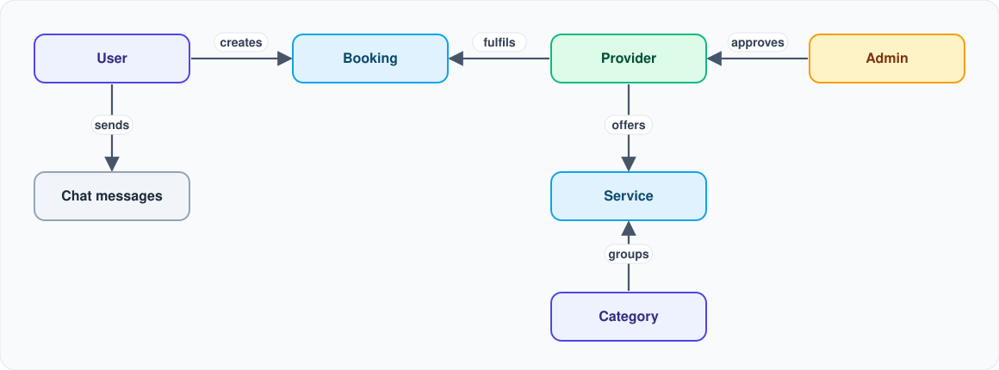
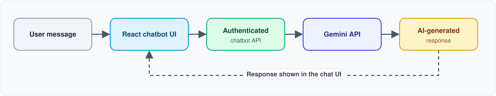

<div align="center">


**Find, book, and track trusted local professionals, all within 5 km of your doorstep.**

<br />


<br />


<br />

[Overview](#-overview) · [Features](#-features) · [How It Works](#-how-it-works) · [Architecture](#-architecture) · [Quick Start](#-quick-start) · [API](#-api-reference) · [Status](#-project-status) · [Contributing](#-contributing) · [Research](#-research-publication)

</div>

---

## 📑 Table of Contents

1. [Overview](#-overview)
2. [Features](#-features)
3. [How It Works](#-how-it-works)
4. [Screenshots & Demo](#-screenshots--demo)
5. [Architecture](#-architecture)
6. [Quick Start](#-quick-start)
7. [Environment Variables](#-environment-variables)
8. [API Reference](#-api-reference)
9. [Real-Time Features](#-real-time-features)
10. [AI Chatbot](#-ai-chatbot)
11. [Machine Learning Module](#-machine-learning-module)
12. [Available Scripts](#-available-scripts)
13. [Testing](#-testing)
14. [Security](#-security)
15. [Deployment](#-deployment-checklist)
16. [Troubleshooting](#-troubleshooting)
17. [More Documentation](#-more-documentation)
18. [Project Status](#-project-status)
19. [Roadmap](#-roadmap)
20. [Contributing](#-contributing)
21. [Research Publication](#-research-publication)
22. [Project Information](#-project-information)
23. [FAQ](#-faq)
24. [License](#-license)
25. [Acknowledgements](#-acknowledgements)
26. [Support](#-support)

---

## 📖 Overview

Need an electrician at 8 PM? A plumber before the weekend? **SMARTCONNECT** is a full-stack, location-aware marketplace that connects residents with **verified** local service providers in their own neighbourhood.

It brings together the MERN stack, MongoDB geospatial search, Google Gemini AI, JWT authentication, and Socket.IO to make the entire journey, from *discovery* to *booking* to *live tracking* to *completion*, simple, transparent, and trustworthy.

> **Mission:** Help people find trusted nearby professionals (electricians, plumbers, carpenters, technicians, and more) within a **5 km radius**.

### At a Glance

| 👥 Roles | 📍 Search radius | ⚡ Live rooms | 🤖 AI engine | 🗄️ Database |
|:---:|:---:|:---:|:---:|:---:|
| User · Vendor · Admin | ≈ 5 km | Provider · Category · User · Booking | Google Gemini | MongoDB `2dsphere` |

### Project Objectives

- Connect users with approved and verified local providers.
- Discover providers near a user's location within a 5 km radius.
- Simplify service discovery and booking.
- Provide AI-assisted conversational support.
- Enable real-time request, status, and location updates.
- Maintain transparent service workflows.
- Give administrators control over verification and platform operations.

### Who Is It For?

Residential societies · Neighbourhoods · Small businesses · Urban and semi-urban communities · Local service marketplaces

### Why SMARTCONNECT?

| | |
|---|---|
| 📍 **Truly local** | Geospatial search surfaces only providers near the user. |
| ✅ **Trusted** | Every provider is reviewed and approved by an administrator before going live. |
| ⚡ **Real-time** | Instant notifications, status updates, and live provider location. |
| 🤖 **AI-assisted** | A Gemini-powered assistant answers local-service questions in natural language. |
| 🔍 **Transparent** | A clear, auditable request lifecycle from first click to final approval. |

<div align="center">
  
  <br /><sub><i>Only approved providers inside your 5 km radius are shown.</i></sub>
</div>

---

## ✨ Features

SMARTCONNECT serves three roles, each with a purpose-built experience.


### 👤 For Users

- Secure registration and login, with **OTP email verification** when SMTP is configured
- Search providers by **category or keyword**, or use **browser geolocation** to find who is nearby
- View provider profiles, services, ratings-related information, and availability
- Create, submit, and track bookings end to end
- Review completed work and **approve or reject** it
- Upload request-related proof images where supported
- Receive **real-time notifications** and watch the provider's **live location**
- Chat with the **AI support assistant**
- Manage profile and account details

### 🛠️ For Vendors

- Register with profile and certification details
- Toggle **online/offline** availability and set a working location
- Receive instant booking notifications
- **Accept or reject** requests, then move work to **In Progress**
- Mark jobs **Completed** with supporting details or images
- Share **live location** through a dedicated Socket.IO booking room
- Manage service information and provider details

### 🛡️ For Administrators

- Dedicated admin dashboard
- Approve or reject provider registrations
- Verify certifications and provider details
- Manage users, providers, categories, and service records
- Monitor active bookings and platform operations
- Enforce **role-based access** for restricted operations

### 🧠 AI, Maps & Real-Time

| Capability | Details |
|---|---|
| **AI chatbot** | Google Gemini via the backend, with authenticated endpoints and chat history |
| **Smart search** | Keyword, category, provider, and location-based discovery |
| **Geospatial engine** | GeoJSON coordinates with a MongoDB `2dsphere` index (≈ 5 km radius) |
| **Maps** | Leaflet and OpenStreetMap interfaces |
| **Live updates** | Socket.IO notifications, status changes, and provider location broadcasts |

---

## 🔄 How It Works


### Service Request Lifecycle

<div align="center">
  
</div>

| Status | Meaning |
|---|---|
| **Requested / Pending** | A user submitted the service request. |
| **Accepted** | The vendor accepted the booking. |
| **In Progress** | The vendor is actively performing the service. |
| **Completed** | The vendor submitted the job and awaits the user's review. |
| **Approved / Closed** | The user approved the completion. |
| **Rejected** | The vendor or user rejected the applicable stage. |

> 💡 Exact status labels may vary by implementation. Confirm them in the booking model and booking controller.

### Live Tracking Flow

<div align="center">
  
</div>

---

## 📸 Screenshots & Demo

> 🚧 **Coming soon.** Real application screenshots, a walkthrough video, and a live deployment are on the [roadmap](#-roadmap) and will be added here as soon as they are ready.

| Resource | Status |
|---|:---:|
| Application screenshots | 🕒 Planned |
| Demo walkthrough video | 🕒 Planned |
| Live deployment | 🕒 Planned |

<!--
When ready, add screenshots to docs/screenshots/ and uncomment the block below.

| Home & Search | Nearby Map | Booking Tracker |
|:---:|:---:|:---:|
|  |  |  |

| Vendor Dashboard | Admin Panel | AI Chatbot |
|:---:|:---:|:---:|
|  |  |  |

🔗 **Live demo:** https://your-demo-url
🎥 **Walkthrough:** https://your-video-url
-->

---

## 🏗️ Architecture

<div align="center">
  
</div>

### Core Components

| Component | Responsibility |
|---|---|
| **Frontend** | User, vendor, and administrator interfaces |
| **Backend** | Authentication, authorization, bookings, providers, search, uploads, chat |
| **MongoDB** | Persistent application and geospatial data |
| **Socket.IO** | Notifications and live location updates |
| **Gemini API** | Contextual chatbot responses |
| **JWT** | Secures authenticated API requests |
| **SMTP** | Optional OTP email delivery |

### Technology Stack

| Category | Technology |
|---|---|
| **Frontend** | React 19, Vite 7, Tailwind CSS 3, PostCSS |
| **Routing & HTTP** | React Router DOM, Axios, Fetch API |
| **Maps** | Leaflet, React-Leaflet |
| **Backend** | Node.js, Express.js |
| **Database** | MongoDB, Mongoose |
| **Geospatial** | GeoJSON, MongoDB `2dsphere` index |
| **Auth & Security** | JWT, bcrypt / bcryptjs |
| **Real-time** | Socket.IO |
| **AI** | Google Gemini API (`@google/genai`) |
| **Email / OTP** | Nodemailer, SMTP |
| **File uploads** | Multer |
| **ML prototype** | Python, TF-IDF / NLP utilities |
| **Version control** | Git, GitHub |

### Database & Geospatial Design

MongoDB stores user accounts and roles, provider profiles and approval status, certification and profile uploads, service categories, GeoJSON locations, booking requests with status history, chat conversations, and live availability metadata.

<div align="center">
  
</div>

<sub>Conceptual relationships only. The Mongoose models in <code>Backend/models/</code> are the source of truth for exact fields.</sub>

Nearby discovery relies on `2dsphere`-indexed GeoJSON coordinates, targeting a radius of approximately **5 km**.

> ⚠️ Provider coordinates must be stored as **`[longitude, latitude]`**, and MongoDB must be allowed to create geospatial indexes.

### Project Structure

```text
SMARTCONNECT/
├── Backend/
│   ├── controllers/       # Request and business logic
│   ├── middlewares/       # Authentication and authorization
│   ├── models/            # Mongoose models
│   ├── routes/            # Express route definitions
│   ├── scripts/           # Database utility scripts
│   ├── seed/              # Seed data scripts
│   ├── services/          # Gemini and admin services
│   ├── uploads/           # Uploaded provider/profile images
│   ├── utils/             # JWT and shared utilities
│   ├── index.js           # Server entry point
│   ├── socket.js          # Socket.IO event handling
│   └── package.json
├── Frontend/
│   ├── public/
│   ├── src/
│   │   ├── assets/        # README banner, illustrations, and diagrams
│   │   ├── Components/    # Shared React components
│   │   ├── context/       # Authentication context
│   │   ├── lib/           # API and Socket.IO helpers
│   │   └── pages/         # Application screens
│   ├── index.html
│   └── package.json
├── ml-model/
│   ├── api/app.py         # Optional Python API entry point
│   ├── dataset/           # Training data
│   ├── model/nlp_model.py # NLP model implementation
│   └── requirements.txt
├── .github/               # Issue and pull request templates
├── LICENSE                # SMARTCONNECT License
└── README.md
```

---

## 🚀 Quick Start

### Prerequisites

| Requirement | Notes |
|---|---|
| **Node.js** 18+ and **npm** | Runtime and package manager |
| **MongoDB** | Community Server or MongoDB Atlas |
| **Google Gemini API key** | Needed for the chatbot |
| **SMTP credentials** | Optional, for OTP emails |
| **Git** | To clone the repository |

### 1. Clone the repository

```bash
git clone https://github.com/AryaSwati321/Smartconnect-_Final-GeminiAiChatbot.git
cd Smartconnect-_Final-GeminiAiChatbot
```

### 2. Start MongoDB

Use a local instance:

```text
mongodb://localhost:27017/smart_connect
```

...or a MongoDB Atlas connection string.

### 3. Set up the backend

```bash
cd Backend
npm install
```

Create `Backend/.env` (see [Environment Variables](#-environment-variables)), then:

```bash
npm run dev
```

The API runs at **http://localhost:5000** by default. You should see:

```text
Server running on port 5000
MongoDB connected
```

### 4. Set up the frontend

In a second terminal:

```bash
cd Frontend
npm install
npm run dev
```

Vite prints the local URL, usually **http://localhost:5173**.

### 5. Open the app

Visit the Vite URL and **allow browser location access** to try nearby-provider discovery.

> 💡 You will run three things side by side: MongoDB, the backend, and the frontend. Use one terminal for each, or run MongoDB as a background service.

---

## 🔐 Environment Variables

<details open>
<summary><b>Backend: <code>Backend/.env</code></b></summary>

```env
# Server
PORT=5000

# Database: use MONGO_URI or MONGODB_URI
MONGO_URI=mongodb://localhost:27017/smart_connect

# Authentication
JWT_SECRET=replace_with_a_long_random_secret
JWT_EXPIRES_IN=7d

# Google Gemini
GEMINI_API_KEY=your_gemini_api_key
GEMINI_MODEL=gemini-2.5-flash

# Optional SMTP configuration for OTP emails
SMTP_SERVICE=gmail
SMTP_HOST=smtp.gmail.com
SMTP_PORT=587
SMTP_USER=your_email@gmail.com
SMTP_PASS=your_email_app_password

# Optional frontend URL for deployment/CORS documentation
CLIENT_URL=http://localhost:5173
```

</details>

<details open>
<summary><b>Frontend: <code>Frontend/.env</code></b></summary>

```env
VITE_API_URL=http://localhost:5000
```

Restart the Vite dev server after changing frontend environment variables.

</details>

| Variable | Required | Purpose |
|---|:---:|---|
| `PORT` | No | Backend port (default `5000`) |
| `MONGO_URI` / `MONGODB_URI` | **Yes** | MongoDB connection string |
| `JWT_SECRET` | **Yes** | Signs authentication tokens |
| `JWT_EXPIRES_IN` | No | Token lifetime (for example `7d`) |
| `GEMINI_API_KEY` | For chatbot | Google Gemini access |
| `GEMINI_MODEL` | No | Defaults to `gemini-2.5-flash` |
| `SMTP_*` | For OTP | Email delivery settings |
| `CLIENT_URL` | No | Frontend origin for deployment/CORS |
| `VITE_API_URL` | **Yes** (frontend) | Backend base URL |

> 🔒 **Never commit real secrets.** Keep API keys, database passwords, JWT secrets, and SMTP app passwords out of Git by adding `.env` files to `.gitignore`, and rotate any credentials that may have been exposed.

---

## 📡 API Reference

All REST endpoints live under these route groups:

| Area | Base Path |
|---|---|
| Authentication | `/api/auth` |
| Providers | `/api/providers` |
| Administrators | `/api/admin` |
| Bookings | `/api/bookings` |
| Categories | `/api/categories` |
| Search | `/api/search` |
| Services | `/api/services` |
| Chatbot | `/api/chatbot` |
| User routes | `/api` |
| Uploaded files | `/uploads` |

**Typical operations:** registering and logging in users and providers · verifying OTPs · listing and searching providers · creating and updating bookings · vendor accept/complete workflows · user approval or rejection · admin provider verification · chatbot messaging · retrieving uploads.

Protected endpoints expect a bearer token:

```http
Authorization: Bearer <JWT_TOKEN>
```

Example request:

```bash
curl http://localhost:5000/api/bookings \
  -H "Authorization: Bearer <JWT_TOKEN>"
```

> The route and controller files in `Backend/routes/` and `Backend/controllers/` are the source of truth for exact paths, request bodies, and response formats.

---

## ⚡ Real-Time Features

Socket.IO rooms keep every role in sync:

| Room | Purpose |
|---|---|
| **Provider** | Provider-specific requests and updates |
| **Category** | Category-specific provider activity |
| **User** | User-specific notifications |
| **Booking** | Live provider location for one booking |

| Direction | Events |
|---|---|
| **Server listens for** | `joinProvider` · `joinCategory` · `joinUser` · `joinBookingRoom` / `joinBooking` · `providerLocation` |
| **Server broadcasts** | `providerLocationUpdate` |

The frontend maintains a shared Socket.IO connection for real-time UI updates.

---

## 🤖 AI Chatbot

<div align="center">
  
</div>

Set `GEMINI_API_KEY` (and optionally `GEMINI_MODEL`) in `Backend/.env`. The backend defaults to `gemini-2.5-flash` when no model is configured. Chatbot endpoints are authenticated and support chat history.

---

## 🧪 Machine Learning Module

The optional `ml-model/` folder is an NLP playground that can grow into text classification, intent detection, service recommendations, or demand analysis.

| File | Purpose |
|---|---|
| `dataset/training_data.json` | Training data |
| `model/nlp_model.py` | NLP model implementation |
| `api/app.py` | Python API entry point |
| `requirements.txt` | Python dependencies |

```bash
cd ml-model
python -m venv .venv

# Windows
.venv\Scripts\activate
# macOS / Linux
# source .venv/bin/activate

pip install -r requirements.txt
python api/app.py
```

> This module is optional unless the related feature is integrated into the main application.

---

## 🧰 Available Scripts

| Location | Command | Description |
|---|---|---|
| `Backend` | `npm start` | Run the Node server |
| `Backend` | `npm run dev` | Run with nodemon (auto-reload) |
| `Frontend` | `npm run dev` | Start the Vite dev server |
| `Frontend` | `npm run build` | Create a production build |
| `Frontend` | `npm run preview` | Preview the production build |
| `Frontend` | `npm run lint` | Run ESLint |

**Database utilities**

```bash
cd Backend
node scripts/make-approved-visible.js
node seed/seed.js
```

> ⚠️ Review these scripts before running them, as they may modify database records.

---

## ✅ Testing

There is no automated test suite yet. Use this manual checklist:

- [ ] User registration and login
- [ ] OTP email delivery (if SMTP is configured)
- [ ] Provider registration and certification upload
- [ ] Admin approval of a provider
- [ ] Nearby provider search using browser location
- [ ] Category filtering and keyword search
- [ ] Booking creation and provider notification
- [ ] Accept / reject and in-progress transitions
- [ ] Completion submission and supporting uploads
- [ ] User approval / rejection of completion
- [ ] Live location updates in the booking room
- [ ] Gemini chatbot responses
- [ ] Admin and role-based access restrictions
- [ ] Frontend production build (`cd Frontend && npm run build`)

### Automated Testing (Planned)

Automated tests are not configured yet. They are tracked as future enhancements in the [roadmap](#-roadmap):

| Planned suite | Scope |
|---|---|
| **Backend API tests** | Core REST endpoints, validation, and error handling |
| **Authentication tests** | Registration, login, OTP flow, JWT protection, role-based access |
| **Booking workflow tests** | Request, accept/reject, in-progress, completion, approve/reject |
| **Frontend build validation** | Lint and production build run automatically on every pull request through GitHub Actions |

---

## 🛡️ Security

**Built in**

- JWT authentication for protected operations
- Role-based route protection for users, vendors, and admins
- bcrypt / bcryptjs password hashing
- Backend authorization middleware
- Multer-based upload handling
- Configurable OTP email delivery
- CORS configuration for frontend/backend communication
- Environment-based secret management

**Before going to production**

- [ ] Replace the fallback development JWT secret
- [ ] Restrict CORS to trusted origins
- [ ] Add secure HTTP headers and a trusted reverse proxy
- [ ] Add request validation and schema sanitization
- [ ] Apply API rate limiting
- [ ] Use HTTPS and secure, HttpOnly cookies where appropriate
- [ ] Add malware scanning and size/type limits for uploads
- [ ] Enable centralized logging and backup policies

**Found a vulnerability?** Please do not open a public issue. Contact the maintainers privately (see [Support](#-support)) so it can be fixed before disclosure.

---

## 🚢 Deployment Checklist

- [ ] Set production MongoDB credentials and network access
- [ ] Configure a strong, unique `JWT_SECRET`
- [ ] Configure a production Gemini API key
- [ ] Configure SMTP with app-specific credentials (if OTP is required)
- [ ] Set `VITE_API_URL` to the deployed backend URL
- [ ] Configure production CORS and allowed origins
- [ ] Build the frontend: `cd Frontend && npm run build`
- [ ] Deploy the backend on Node-compatible hosting
- [ ] Provide persistent or cloud storage for uploads
- [ ] Enable HTTPS for frontend and backend
- [ ] Create the required MongoDB geospatial indexes
- [ ] Monitor logs, backups, Socket.IO connections, and API usage

---

## 🩺 Troubleshooting

<details>
<summary><b>MongoDB does not connect</b></summary>

- Confirm MongoDB is running or your Atlas credentials are valid.
- Check `MONGO_URI` / `MONGODB_URI` in `Backend/.env`.
- Verify database network access and IP allowlists.

</details>

<details>
<summary><b>Frontend cannot reach the backend</b></summary>

- Confirm `VITE_API_URL` is correct.
- Confirm the backend is running on port 5000 (or your configured port).
- Restart Vite after changing `.env`.

</details>

<details>
<summary><b>OTP email is not sent</b></summary>

- Verify `SMTP_USER` and `SMTP_PASS`.
- Use an SMTP/app password supported by your email provider.
- Check firewall and outbound SMTP restrictions.

</details>

<details>
<summary><b>Gemini responses fail</b></summary>

- Verify `GEMINI_API_KEY` is valid.
- Confirm `GEMINI_MODEL` is available to your account.
- Review backend logs for quota or authentication errors.

</details>

<details>
<summary><b>Nearby providers are not displayed</b></summary>

- Allow browser geolocation access.
- Ensure provider coordinates are valid GeoJSON (`[longitude, latitude]`).
- Confirm MongoDB has the required `2dsphere` index.
- Verify providers are approved and within the 5 km radius.

</details>

<details>
<summary><b>Socket updates do not appear</b></summary>

- Confirm frontend and backend use the same API origin.
- Ensure the relevant booking, provider, or user room has been joined.
- Check the browser console and backend Socket.IO logs.

</details>

---

## 📚 More Documentation

The repository root includes extra guides you may find useful:

| Guide | Description |
|---|---|
| [DEMO_GUIDE.md](https://github.com/AryaSwati321/Smartconnect-_Final-GeminiAiChatbot/blob/main/DEMO_GUIDE.md) | Walkthrough for demonstrating the platform |
| [DEPLOYMENT_GUIDE.md](https://github.com/AryaSwati321/Smartconnect-_Final-GeminiAiChatbot/blob/main/DEPLOYMENT_GUIDE.md) | Deployment instructions |
| [DEPLOYMENT_CHECKLIST.md](https://github.com/AryaSwati321/Smartconnect-_Final-GeminiAiChatbot/blob/main/DEPLOYMENT_CHECKLIST.md) | Pre-launch checklist |
| [FRONTEND_SETUP_GUIDE.md](https://github.com/AryaSwati321/Smartconnect-_Final-GeminiAiChatbot/blob/main/FRONTEND_SETUP_GUIDE.md) | Frontend setup details |
| [FAQ_AND_TROUBLESHOOTING.md](https://github.com/AryaSwati321/Smartconnect-_Final-GeminiAiChatbot/blob/main/FAQ_AND_TROUBLESHOOTING.md) | Common questions and fixes |
| [VENDOR_APPROVAL_SYSTEM_GUIDE.md](https://github.com/AryaSwati321/Smartconnect-_Final-GeminiAiChatbot/blob/main/VENDOR_APPROVAL_SYSTEM_GUIDE.md) | How vendor approval works |
| [QUICK_REFERENCE.md](https://github.com/AryaSwati321/Smartconnect-_Final-GeminiAiChatbot/blob/main/QUICK_REFERENCE.md) | Quick reference |

---

## 📈 Project Status

SMARTCONNECT is under active development. This table shows what is in place today and what is still planned.

| Area | Status | Notes |
|---|:---:|---|
| Core platform (users, vendors, admin) | ✅ Available | Bookings, geospatial search, real-time updates, AI chatbot |
| Open-source license | ✅ Available | [SMARTCONNECT License](LICENSE) |
| Issue and PR templates | ✅ Available | See the `.github/` folder |
| Application screenshots | 🕒 Planned | Will be added to the README |
| Demo walkthrough video | 🕒 Planned | Will be linked in the README |
| Live deployment | 🕒 Planned | Public demo link to follow |
| Automated tests | 🕒 Planned | API, authentication, booking workflow |
| Continuous integration (CI) | 🕒 Planned | Lint and build checks on pull requests |
| Release tags and changelog | 🕒 Planned | Semantic versioning, starting at `v1.0.0` |
| GitHub repository metadata | 🕒 Planned | Description, topics, and website link |
| Community feedback loop | 🕒 Planned | Early testers, bug reports, and reviewed pull requests |

---

## 🗺️ Roadmap

### Product

- [ ] 💳 Online payment gateway integration
- [ ] ⭐ Vendor and customer ratings and reviews
- [ ] 🎯 Advanced AI-based provider recommendations
- [ ] 🧭 Google Maps integration and route navigation
- [ ] 🌐 Multilingual chatbot support
- [ ] 📊 Analytics and reporting dashboards
- [ ] 📱 Mobile application
- [ ] 📅 Appointment and recurring-service scheduling
- [ ] ⏱️ Vendor performance and response-time monitoring
- [ ] 📈 AI-powered demand prediction and dynamic availability
- [ ] 🖼️ Image-based service issue classification
- [ ] 🔔 Push and SMS notifications

### Documentation & Demo

- [ ] 📸 Add real application screenshots
- [ ] 🎥 Record and publish a demo walkthrough video
- [ ] 🌍 Deploy a working live demo and add the link

### Quality & Testing

- [ ] 🧪 Backend API tests
- [ ] 🔐 Authentication tests (registration, login, OTP, JWT, roles)
- [ ] 📋 Booking workflow tests (request through approval)
- [ ] 🏗️ Frontend build validation
- [ ] ⚙️ GitHub Actions CI to run lint, tests, and build on every pull request

### Project Health & Community

- [ ] 🏷️ Publish release tags (`v1.0.0` and onward) with a changelog
- [ ] 🧾 Keep a history of small, meaningful commits
- [ ] 🐞 Track bugs and features through GitHub Issues
- [ ] 👀 Review pull requests before merging
- [ ] 🧭 Configure GitHub repository description, topics, and website
- [ ] 🙋 Invite early users and developers to test, report bugs, and contribute

---

## 🤝 Contributing

Contributions of every size are welcome, from typo fixes to new features.

**We would love real users and developers to get involved.** You can help by:

- 🧪 **Testing** the platform and sharing what felt smooth or confusing
- 🐞 **Reporting bugs** through [GitHub Issues](https://github.com/AryaSwati321/Smartconnect-_Final-GeminiAiChatbot/issues/new/choose)
- 💡 **Suggesting features** or improvements
- 🔧 **Fixing issues** or adding tests through pull requests
- 📖 **Improving documentation**

All pull requests are reviewed before they are merged.

1. **[Fork the repository](https://github.com/AryaSwati321/Smartconnect-_Final-GeminiAiChatbot/fork)** and clone your fork.
2. **Create a branch** from `main`:
   ```bash
   git checkout -b feature/your-feature-name
   ```
3. **Make your changes**, following the existing code style, and run `npm run lint` in `Frontend`.
4. **Test manually** using the [checklist above](#-testing).
5. **Commit** with a clear message, for example `feat: add provider rating field`.
6. **Push** your branch and open a **Pull Request** describing what changed and why.

**Good first contributions:** automated tests, ratings and reviews, accessibility improvements, documentation, and UI polish. Check the [roadmap](#-roadmap) for open ideas.

**Reporting bugs?** Use the bug report template when you [open an issue](https://github.com/AryaSwati321/Smartconnect-_Final-GeminiAiChatbot/issues/new/choose). Include steps to reproduce, expected versus actual behaviour, and your environment (OS, Node version, browser).

Please be respectful and constructive in all discussions.

---

## 🎓 Research Publication

SMARTCONNECT is associated with the following research publication.

| | |
|---|---|
| **Journal** | International Journal of Scientific Research in Engineering and Management (IJSREM) |
| **Volume / Issue** | 10 / 5 |
| **Published** | May 2026 |
| **Manuscript ID** | IJSREM62478 |

<details>
<summary><b>Cite this work</b></summary>

```bibtex
@article{smartconnect2026,
  title   = {SMARTCONNECT: AI-Based Hyperlocal Community Hub},
  author  = {Arya Walse},
  journal = {International Journal of Scientific Research in Engineering and Management (IJSREM)},
  volume  = {10},
  number  = {5},
  year    = {2026},
  month   = {May},
  note    = {Manuscript ID: IJSREM62478}
}
```

Please verify these details against the publisher's official record, and add any co-authors, before using this entry.

</details>

---

## 📌 Project Information

| | |
|---|---|
| **Name** | SMARTCONNECT, AI-Based Hyperlocal Community Hub |
| **Owner** | Arya Walse |
| **Type** | Final Year Engineering Project |
| **Domain** | Full Stack Development, Artificial Intelligence, Web Technologies |
| **Architecture** | MERN stack with geospatial and real-time features |
| **Objective** | Connect users with trusted local service providers through a location-aware, AI-powered platform |

### Owner & Maintainer

| | |
|---|---|
| **Name** | Arya Walse |
| **GitHub** | [@AryaSwati321](https://github.com/AryaSwati321) |
| **Email** | [aryaswati1907@gmail.com](mailto:aryaswati1907@gmail.com) |

---

## ❓ FAQ

<details>
<summary><b>Why a 5 km radius?</b></summary>

SMARTCONNECT is built around the hyperlocal idea: the best provider is usually a short trip away, which means faster response times and a stronger sense of community trust.

</details>

<details>
<summary><b>Do I need SMTP to run the project?</b></summary>

No. SMTP is only needed for OTP email verification. Without it, the rest of the platform works normally.

</details>

<details>
<summary><b>Do I need a Gemini API key?</b></summary>

Only for the AI chatbot. Other features run without it.

</details>

<details>
<summary><b>Can I use MongoDB Atlas instead of a local database?</b></summary>

Yes. Put your Atlas connection string in `MONGO_URI` and make sure your IP address is allowed in Atlas network access.

</details>

<details>
<summary><b>How are providers verified?</b></summary>

Vendors register with profile and certification details. An administrator reviews them and approves or rejects the registration. Only approved providers appear in search results.

</details>

<details>
<summary><b>Is the ML module required?</b></summary>

No. It is an optional prototype that can be extended independently.

</details>

---

## 📜 License

**SMARTCONNECT** is released under the **[SMARTCONNECT License](LICENSE)**, a permissive open-source license.

Copyright © 2026 Arya Walse. You are free to use, copy, modify, merge, publish, distribute, sublicense, and sell copies of the software, provided the copyright and license notice are included in all copies or substantial portions of it. The software is provided "as is", without warranty of any kind.

See the [LICENSE](https://github.com/AryaSwati321/Smartconnect-_Final-GeminiAiChatbot/blob/main/LICENSE) file for the full text.

---

## 🙏 Acknowledgements

SMARTCONNECT is built on the shoulders of excellent open-source and platform technologies:

- [React](https://react.dev) and [Vite](https://vitejs.dev)
- [Tailwind CSS](https://tailwindcss.com)
- [Leaflet](https://leafletjs.com) and [OpenStreetMap](https://www.openstreetmap.org) contributors
- [Node.js](https://nodejs.org) and [Express](https://expressjs.com)
- [MongoDB](https://www.mongodb.com) and [Mongoose](https://mongoosejs.com)
- [Socket.IO](https://socket.io)
- [Google Gemini](https://ai.google.dev)
- [Nodemailer](https://nodemailer.com) and [Multer](https://github.com/expressjs/multer)

Special thanks to our project guide, institution, and everyone who tested and gave feedback.

---

## 💬 Support

- 🐛 **Bugs and feature requests:** [open a GitHub issue](https://github.com/AryaSwati321/Smartconnect-_Final-GeminiAiChatbot/issues/new/choose)
- 💡 **Questions and ideas:** start a [GitHub discussion](https://github.com/AryaSwati321/Smartconnect-_Final-GeminiAiChatbot/discussions) or email the maintainer
- 🔒 **Security concerns:** email privately instead of opening a public issue
- 📧 **Contact:** Arya Walse, [aryaswati1907@gmail.com](mailto:aryaswati1907@gmail.com)

If SMARTCONNECT is useful to you, please consider giving the repository a ⭐.

---

<div align="center">

**SMARTCONNECT: Bridging Communities Through Technology.**

Made with ❤️ for local communities by **Arya Walse**.

</div>
